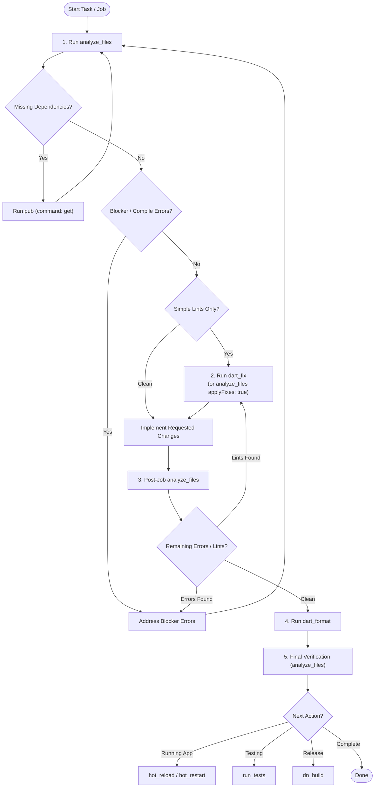

# DartNative MCP Skill

The `dartnative` MCP server exposes the DartNative `dn` CLI, the Dart analyzer, and the Dart Tooling Daemon (DTD) to your agent. Always prefer these tools over running shell commands.

This skill is organized modularly using progressive disclosure. Consult the dedicated reference guides in [`references/`](./references/) for deep dives into specific subsystems.

---

## 1. Core Principles & Mandatory Rules

### Rule 1: Always Start With Analysis (`analyze_files`)
- **Initial Action**: The analysis command (`analyze_files` or `dn_analyze`) **must always be the first action** taken when starting work on a codebase, task, or bug fix.
- **Diagnostics First**: Never edit files blindly. Run `analyze_files` to surface:
  - Missing dependencies (e.g. `uri_does_not_exist` or unresolved imports).
  - Syntax errors, type mismatches, and unresolved references.
  - Active warnings and lints.
- **Dependency Resolution**: If missing package dependencies are reported, immediately call `pub` with `command: "get"` before proceeding.
- *Full Guide*: See [`references/analysis_and_formatting.md`](./references/analysis_and_formatting.md).

### Rule 2: Auto-Fix Simple Lints with `dart_fix` (Never Edit Manually)
- When analysis returns no blocker errors but has simple lints, style issues, or automated fix candidates (e.g., deprecated syntax, unnecessary `new`/`const`, import sorting):
  - **Do NOT manually edit files one by one.**
  - **Use `dart_fix`** (or call `analyze_files` with `applyFixes: true`) to resolve them automatically across the project.
- Only manually edit files when human architectural or logical decisions are required.
- *Full Guide*: See [`references/analysis_and_formatting.md`](./references/analysis_and_formatting.md).

### Rule 3: Always Analyze & Format After Every Job
- After completing code modifications, bug fixes, or feature implementations:
  1. **Re-run `analyze_files`**: Confirm that all targeted issues are resolved and no regressions or new warnings were introduced.
  2. **Run `dart_format`**: Ensure all modified files and project roots conform to official Dart formatting rules.
- *Full Guide*: See [`references/analysis_and_formatting.md`](./references/analysis_and_formatting.md).

### Rule 4: Only `dn` and `dart`
- DartNative projects are built and managed with `dn`; analysis, automated fixes, and formatting use `dart`.
- Do not invoke foreign SDK CLIs (such as `flutter`). Use the matching MCP tool instead of running shell commands whenever one exists.

### Rule 5: Search Before You Add
- Never guess a package name. Find it first:
  - Native capability (camera, sheet, permissions, maps) → `dartpub_search` (DartNative plugin registry on dartpub.dev).
  - Ordinary Dart package (`http`, `path`, `json`) → `pub_dev_search` (pub.dev).
- `dartpub_search` does **not** search pub.dev packages; `pub_dev_search` does not search DartNative plugins.
- Read the plugin's `readme` with `detail: "readme"` before writing integration code, then install with `pub` `command: "add"` and `packageNames`.
- *Full Guide*: See [`references/pub_search.md`](./references/pub_search.md).

---

## 2. Standard Workflow Lifecycle

---

## 3. Modular Reference Guides

Detailed instructions, schemas, parameter tables, and tool recipes are separated into modular guides:

| Reference Guide | Topics Covered | Key Tools |
| :--- | :--- | :--- |
| [`analysis_and_formatting.md`](./references/analysis_and_formatting.md) | Initial analysis, error detection, automated lint fixing, formatting, post-job checks | `analyze_files`, `dart_fix`, `dart_format`, `dn_analyze` |
| [`dependencies_and_pub.md`](./references/dependencies_and_pub.md) | Resolving dependencies, adding/removing packages, auditing the dependency tree | `pub` |
| [`pub_search.md`](./references/pub_search.md) | Finding DartNative plugins vs. pub.dev packages, query syntax, inspecting READMEs/examples/changelogs, judging package health | `dartpub_search`, `pub_dev_search` |
| [`devices_and_apps.md`](./references/devices_and_apps.md) | Listing devices, launching apps, reading logs, stopping running apps | `dn_devices`, `dn_run`, `dn_app_logs`, `dn_stop_app`, `dn_install` |
| [`runtime_and_dtd.md`](./references/runtime_and_dtd.md) | Connecting to Dart Tooling Daemon, hot reload vs hot restart, runtime errors | `dtd`, `hot_reload`, `hot_restart`, `get_runtime_errors` |
| [`build_and_test.md`](./references/build_and_test.md) | Release compilation, running tests, cleaning builds, toolchain diagnostics | `run_tests`, `dn_build`, `dn_clean`, `dn_doctor`, `create_project` |
| [`code_intelligence.md`](./references/code_intelligence.md) | Hover docs, signature help, workspace symbols, reading & grepping package sources | `lsp`, `read_package_uris`, `rip_grep_packages` |

---

## 4. Important Notes

- **Workspace Roots**: Tools taking `roots` accept the project root as a `file:` URI. Omit `roots` to automatically use the client-provided workspace roots.
- **Process Management**: `dn_run` keeps the application process alive. Always call `dn_stop_app` when testing or debugging is finished to free device resources.
- **`dart_format` and `dart_fix`**: Handled via the Dart SDK because `dn` delegates formatting and automated fixes directly to `dart`.
