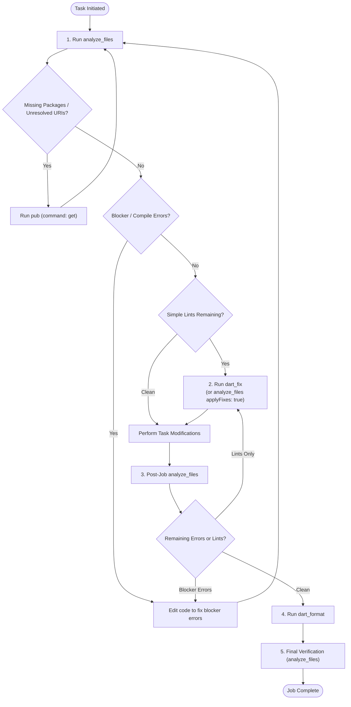

# Code Analysis, Automated Lint Fixing & Formatting

This guide covers the mandatory lifecycle for analyzing code, resolving missing dependencies, automatically applying lint fixes, and formatting in DartNative projects.

---

## 1. Core Rules

### Rule 1: Always Run Analysis First (`analyze_files` / `dn_analyze`)
- **First Action**: Every single task—whether fixing a bug, adding a feature, or refactoring—**must begin with an analysis run**. Never inspect or edit files blindly.
- **Diagnostics First**: Calling `analyze_files` gives structured diagnostics covering:
  - **Missing Dependencies**: Unresolved imports or `uri_does_not_exist` errors indicating dependencies need to be installed.
  - **Syntax & Compile Errors**: Unresolved names, type mismatches, missing methods, or broken signatures.
  - **Warnings & Lints**: Deprecated API usage, style discrepancies, unused code.
- **Dependency Resolution**:
  - If analysis reports `uri_does_not_exist` or missing packages, immediately invoke the `pub` tool with `command: "get"`.
  - Once dependencies are downloaded, re-run `analyze_files` to obtain the actual code diagnostics.

### Rule 2: Auto-Fix Simple Lints with `dart_fix` (Never Edit Manually)
- When analysis shows simple lints, style warnings, or automated fix candidates and no blocker compile errors (or after blocker errors are resolved):
  - **Never manually open and edit individual files by hand** to fix trivial lints (e.g. `unnecessary_new`, `unnecessary_const`, `prefer_single_quotes`, deprecated imports, unused imports).
  - **Always run `dart_fix`** (or `analyze_files` with `applyFixes: true`).
  - Dart's built-in fix engine applies the required fixes across all project files reliably, quickly, and error-free.

### Rule 3: Always Analyze & Format After Every Job
- Once code modifications or jobs are completed:
  1. **Run `analyze_files`**: Confirm that all targeted problems are fixed and 0 new errors or warnings were introduced.
  2. **Run `dart_format`**: Ensure all modified files and project roots conform strictly to official Dart style rules.

---

## 2. Analysis & Fix Lifecycle



---

## 3. Tool Reference & Details

### `analyze_files`
- **Purpose**: Runs the Dart Analysis Server against project roots or specific file paths. Returns structured JSON diagnostics with line numbers, column numbers, severities, and error codes.
- **Parameters**:
  - `roots` (optional): List of workspace root objects `{"root": "file:///path/to/project"}` or specific file paths. If omitted, uses active workspace roots.
  - `applyFixes` (optional boolean, default `false`): When `true`, automatically applies quick fixes to the files before returning the remaining diagnostics.
- **Example Call (Initial Diagnostic)**:
  ```json
  {
    "ServerName": "dartnative",
    "ToolName": "analyze_files",
    "Arguments": {}
  }
  ```
- **Example Call (With Quick Fixes Applied)**:
  ```json
  {
    "ServerName": "dartnative",
    "ToolName": "analyze_files",
    "Arguments": {
      "applyFixes": true
    }
  }
  ```

---

### `dart_fix`
- **Purpose**: Executes `dart fix --apply` across the specified roots or workspace.
- **When to use**: Whenever lints, deprecations, or autofixable warnings are detected and blocker compiler errors are resolved.
- **Parameters**:
  - `roots` (optional): List of project roots to fix.
- **Example Call**:
  ```json
  {
    "ServerName": "dartnative",
    "ToolName": "dart_fix",
    "Arguments": {}
  }
  ```

---

### `dart_format`
- **Purpose**: Formats Dart source code using `dart format .` according to language guidelines.
- **When to use**: Mandatory after any code modifications before completing the task.
- **Parameters**:
  - `roots` (optional): List of roots or specific file paths to format.
- **Example Call**:
  ```json
  {
    "ServerName": "dartnative",
    "ToolName": "dart_format",
    "Arguments": {}
  }
  ```

---

### `dn_analyze`
- **Purpose**: Runs `dn analyze` directly through the DartNative CLI and outputs raw command-line text.
- **When to use**: Use when specifically comparing DartNative CLI compiler messages with standard analysis or when raw CLI exit codes and output strings are required.
- **Example Call**:
  ```json
  {
    "ServerName": "dartnative",
    "ToolName": "dn_analyze",
    "Arguments": {}
  }
  ```

---

## 4. Diagnostics Classification & Handling

| Category | Typical Codes | Recommended Action |
| :--- | :--- | :--- |
| **Missing Dependency** | `uri_does_not_exist`, `unresolved_import` | Call `pub` with `command: "get"` |
| **Simple Lint / Style** | `unnecessary_new`, `unnecessary_const`, `prefer_single_quotes`, `avoid_init_to_null` | Call `dart_fix` (do NOT edit manually) |
| **Deprecated API (Autofixable)** | `deprecated_member_use_from_same_package`, `deprecated_member_use` with quick fix | Call `dart_fix` |
| **Syntax / Logic Error** | `undefined_class`, `undefined_identifier`, `argument_type_not_assignable` | Inspect file location and edit manually |
| **Unformatted Code** | Formatting discrepancies | Call `dart_format` |
